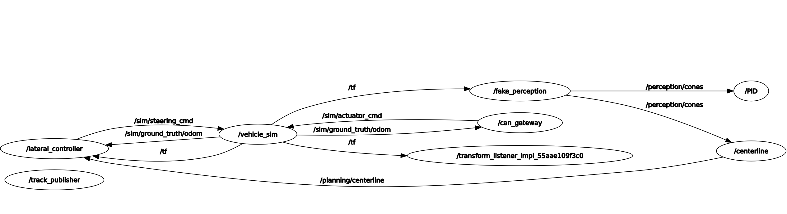
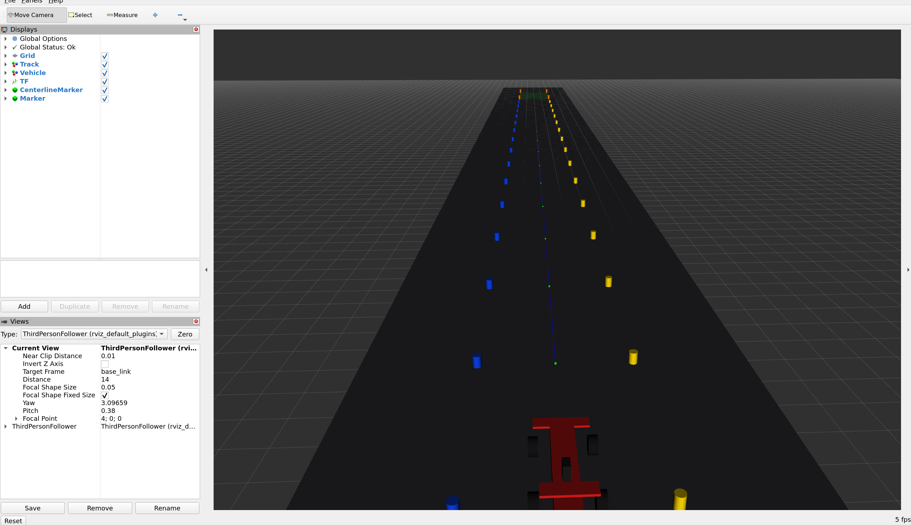

# Report

## Table of Contents

- [Task Overview](#task-overview)
- [Code Overview](#code-overview)
- [PID Tuning](#pid-tuning)
- [Additional Notes and Materials](#additional-notes-and-materials)
- [Use of AI](#use-of-ai)

---
## Task Overview
The objective of this task i to drive a simulated Formula Student car across an acceleration path  and make it stop inside a finish zone.

To achieve this, I initially considered two different approaches:
- **Empirical controller:** A simple controller that makes the car accelerate and then start braking based on the cone reached. It is a trial-and-error based approach used as starting point to verify that the rest of the code correctly communicates with the vehicle.
- **Kinematic controller:** This approach relies on the equations of uniformly decelerated motion. The main idea is to make the car accelerate as much as possible and periodically check whether the remaining distance from the finish zone is less than equal to the required space to stop the car.
	- Although this approach works in the simulated environment, it has one major limitation: on a sufficiently long track, the car will reach a speed that is too high to allow it to stop inside the finish zone (due to insufficient braking space, considering the car's limited range of sight)
	- In other words, when the car detects the finish zone cone, at a distance of 50m from the vehicle, the remaining distance may be insufficient for the car to stop at its current speed

**PID controller + braking logic:** To address this limitation, I've implemented a PID controller to regulate the vehicle speed according to a provided target value. By limiting the vehicle speed, this approach helps ensure that the stopping distance remains within the available range of sight. Additionally, I've kept the braking logic of the kinematic approach, which determines when the car needs to start braking to stop inside the finish zone.

Further details about this last approach are presented in the sections below.

---
## Code Overview

The structure of the code presents two Nodes: `/PID` (responsible for controlling the vehicle), and `/centerline` (responsible for computing and publishing the center of the track).



## `/PID`

The `/PID` node is responsible for controlling the vehicle, in particular:
- Sends the `AS_CMD` command, containing information about the requested throttle and brake value (plus the `Mission_finished` boolean value) to the car every 10ms;
- Reads every 10ms the measure speed of the car, which is provided via CAN bus
- Contains the logic according to which the car starts accelerating and starts breaking in order to stop inside the finish zone

The execution and the code of this node is organized as follows:
### `initCAN()`

First, the node executes this function once at startup. The function is responsible for the initialization of the CAN bus. To do so, it first opens the CAN socket, then it sets the I/O attributes, the address attributes and finally it binds the address to the socket.

### `send_AS_CMD()`
Every 10ms, the node calls this function, responsible for sending to the car the command containing the updated values of the requested throttle, brake, and the boolean value of the `mission_finished` variable. It is essential to periodically send it to the car in order to avoid it engaging the emergency brake.

### `readSpeed()`
This function is responsible for reading the car measured speed via the CAN bus.
In order to do so, we first need to receive the CAN frame, unpack it and then read the speed value.

### `check()`
The `check()` function has been used as part of setting up the parameters of the car that were subsequently needed for the completion of the task. The function, once the simulator has finished loading and it is ready (i.e., when we receive the first CAN frame), performs the following steps:
- First, it makes the car accelerate at maximum throttle (`ThrottleReq` = 1) for 3s;
- Then, it measures the maximum speed reached by the car and sets `ThrottleReq` to zero and `BrakeReq` to maximum (=1) in order to measure the maximum output deceleration of the brakes
- During the braking phase, the function measures the time required for the vehicle to completely stop

After following the above-mentioned steps, the function calculates: the maximum acceleration of the car, and the maximum deceleration of the brakes. Such values are then stored and used as constants

*Note:* in my implementation, I've considered the average acceleration and deceleration across four measurements. Moreover, my code actually uses only the deceleration of the brakes (which, among the two units, it is the one with the least variation across the four measurements, unlike the acceleration value which is influenced by the startup of the simulator and therefore presents higher variability since in some cases the 3s timer starts a little bit earlier than the acceleration phase).

## `PID_fsm()`
This function is responsible for making the car reach the finish zone as fast as possible. It is composed of two main parts: the PID controller, and the braking logic.

#### The PID controller
The PID controller regulates the vehicle speed toward a specified `target_speed` by considering the difference between the actual speed of the car  and the one to achieve. The aggressiveness of the behavior of the controller depends on three parameters: `KP`, `KI`, `KD`. Such parameters need to be tuned according to the specific case. See the [PID Tuning](#pid-tuning) section for further details.

``` C++
// Implementation of the PID logic
error_sum += error * (time - prev_time);
output = KP * error + KI * error_sum + KD * (error - prev_error) / (time - prev_time);
```

The output provided by the PID is then:
- Translated into a `ThrottleReq` if it is positive
- Translated into a `BrakeReq` if it is negative
- Clamped within the range of maximum physical values of both brakes and throttle (which is equal to 1)

#### The braking logic
The PID controller is paired with a braking system that determines when the car needs to stop accelerating and needs to start slowing down. The logic considers:
- The range of sight of the car (in this case equal to 50m);
	- Used to calculate the maximum `target_speed` that allows the car to stop within its range of sight, considering the deceleration of the brakes
- The maximum deceleration of the brakes;
- The speed of the car (at the moment of calculation)
- The remaining space available for the last cone of the finish zone (the furthest orange cone seen)
- A tolerance of 4m from the last cone of the finish zone in order to stop inside of it (and not at the edge or possibly after)

When the braking system detects that the required space to stop the car is greater than or equal to the remaining space available (considering the tolerance), it changes the status of the car from `ACCELERATING` to `BRAKE`, turns off the throttle and sets the `BrakeReq` to 1 (the maximum).

Finally, when the logic detects that the car has stopped (detected speed equal to zero), the function sets `BrakeReq` to zero and sets `MissionFinished` to true.

``` C++
// Implementation of the braking logic
double space_from_finish = msg.cones.size() / 2 * 5 - 4;
double braking_space_required = 0.5 * (vehicle_status.vehicle_speed * vehicle_status.vehicle_speed) / BRAKE_A;
 if (msg.cones[msg.cones.size() - 1].color == 3 && space_from_finish <= braking_space_required) {
	 state = BRAKE;
	 vehicle_status.throttle = 0;
	 vehicle_status.brake = 1;
}
```

*Notes:*
- All parameters and constants of the two components of this functions are loaded from `src/ctrl/config/params.yaml`
- The implementation considers the magnitude of the braking deceleration and assumes uniformly decelerated motion during braking

---
## `/centerline`

The `/centerline` node is responsible for receiving the car-detected cones of the track that are published in the `/perception/cones` topic.

After receiving them, the Node computes the center line of the track and publishes the corresponding path to follow to `/planning/centerline`.

- To calculate the center point, the Node takes each right + left cone pair and computes the middle point between them, which pose coordinates are equal to:$$
(\frac{x1 + x2}{2}; \frac{y1 + y2}{2}; \frac{z1 + z2}{2}; w = 1)
  $$
	- (where `w` indicates the orientation, which in our case is never changed since it remains equal from start to finish zone)
- After calculating each `Pose` we need to wrap each of them inside a `PoseStamped` and finally append them into the `Path` object.
- Once the Path has been computed, the Node publishes it to `/planning/centerline`

All the steps explained above are executed every time the node receives a message from the `/perception/cones` topic.

Additionally, this node creates a "copy" of the path to follow in the form of a Marker, composed of a list of green points (each one located at the middle of the corresponding right and left cone pairs) and a continuous blue line that connects each point. Both markers are published in the `centerline/marker` topic, which is then used in Rviz for displaying the path that the car is following.

The markers are updated with a frequency of 10Hz.



---
## PID Tuning
In order to tune the three parameters `KP`, `KI`, `KD` of the PID, I've followed these steps:

- First I've set to zero all three parameters
- Then I've started tuning the `KP` parameter, obtaining the following curve

.png)

- After tuning the `KP` parameter, I've tuned the `KI` one, obtaining the following output curve:

.png)

- Finally I've tuned the `KD` parameter, obtaining the following final output response:

.png)

*Note:* For the tuning procedure of the PID I've considered a `target_speed` of 10m/s since the actual `target_speed` used during the final runs (`~35m/s`) takes longer in order to be achieved and, for the case of the track length of the simulation, is never reached.
Moreover, using a lower `target_speed` makes it easier to observe the controller's response.

---
## Additional Notes and Materials

#### Successful run plot

.png)

#### Potential bugs
It may happen during a run that the car engages the emergency brake due to a timeout from the last `AS_CMD` command. One possible cause is the usage of blocking CAN read operations, which may delay subsequent command transmissions.

In such cases it is usually sufficient to re-launch the program.

---
## Use of AI
In this work, AI tools (e.g., Claude) have been used solely for debugging (error explanation) and study (further clarifications about tutorials or documentation) purposes. All code and material provided by this repository has been developed by the author. AI tools were not used to generate or modify the code or the content of this work.
